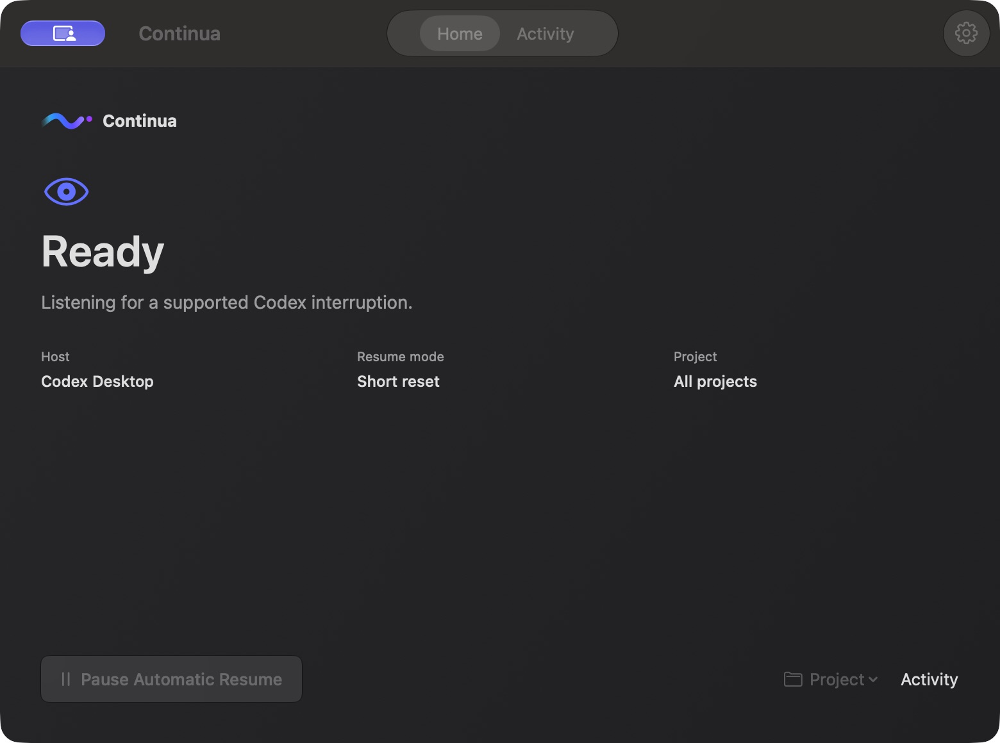
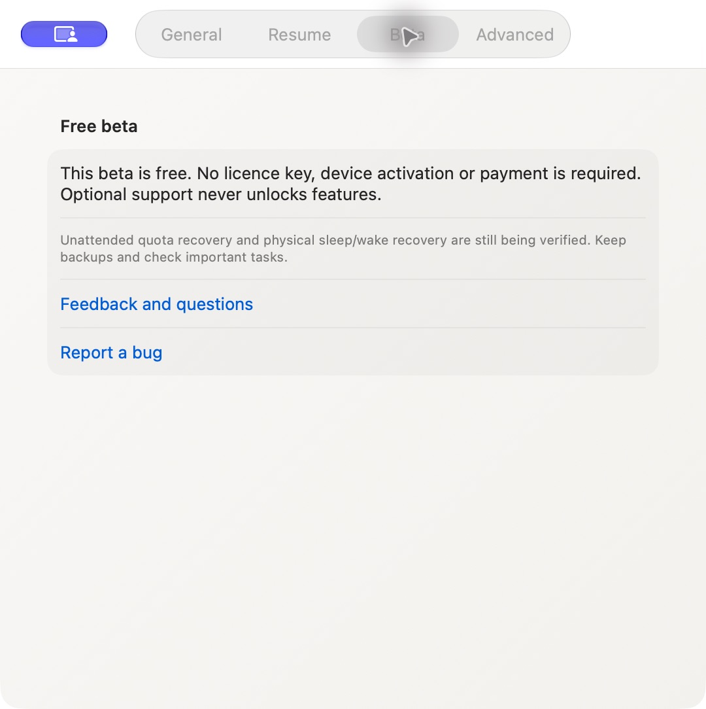

# Continua — free Mac beta

Codex hit its usage limit while you were away?

I’m building Continua to preserve an interrupted Codex task, wait for usage to return, and continue that same task in its original environment. It does **not** bypass or extend usage limits.

[Download Continua 0.3.2 — free Mac beta](https://github.com/bruceclng-cloud/Continua-Releases/releases/tag/v0.3.2-beta.1). No purchase, licence key, activation or donation is required. This repository is for binary downloads and feedback; the application source remains private.

- [Website](https://continua-nu.vercel.app)
- [Releases](https://github.com/bruceclng-cloud/Continua-Releases/releases)
- [Feedback, questions and ideas](https://github.com/bruceclng-cloud/Continua-Releases/discussions)
- [Report a bug](https://github.com/bruceclng-cloud/Continua-Releases/issues/new/choose)
- [Illustrated installation guide](https://continua-nu.vercel.app/install)

## What the current beta does

- Tracks supported Codex Desktop usage-limit interruptions and is designed to continue the same task when usage returns and its environment can be verified.
- Records confirmed task starts and outcomes in local **Activity → Quota cycles**, so you can inspect what actually resumed.
- Runs on **macOS 13 or later**, on Apple silicon and Intel. No purchase or licence key. CLI support is disabled in this beta.

Version 0.3.2 adds quota-cycle history and a frosted rice-white interface. Updates are manual: quit Continua, then replace the app in Applications. [Read the current release notes](https://github.com/bruceclng-cloud/Continua-Releases/releases/tag/v0.3.2-beta.1).

## Inside the Mac app

Earlier development interface, 14 October 2026. The current 0.3.2 beta uses a frosted rice-white appearance. This screenshot is an older interface preview, not evidence of a completed unattended recovery test.

Public beta settings, 13 October 2026. If you try it, start with an unimportant task and tell me where the workflow feels unclear or stops unexpectedly.

## Help test the beta

I’m looking for five Mac users who hit Codex usage limits. Start with an installation and first-open check, then tell me what happened. A genuine recovery test is separate and can take longer. [See the tester steps](https://continua-nu.vercel.app/download/#beta-test) and [share your findings in Discussions](https://github.com/bruceclng-cloud/Continua-Releases/discussions). No extra account, promotion, donation or positive review is required.

## Tell me what you think

Does this solve a real problem for you? What interrupted your task? What should work differently? Honest criticism is welcome. You don’t need to donate or leave a positive review. A GitHub account is needed to post; you can also email getcontinua@gmail.com.

Please keep licence keys, passwords, API keys and private project information out of public posts. Share a redacted screenshot and the app/macOS/Codex version where useful.

## Beta limitations

This is experimental software, not a fully accepted stable release. Genuine unattended quota recovery, physical sleep/wake recovery and complete resource acceptance remain unverified. A prior Debug wake crash is unresolved. Keep backups, review agent permissions and check important tasks yourself.

The beta targets Codex Desktop. CLI support is disabled in this beta. Compatibility depends on the exact host and task environment; Continua waits or asks for attention when it cannot verify them. No automatic update system is enabled.

The download is unsigned and not Apple-notarized. Read the installation guide before downloading. Only use macOS’s per-app Open Anyway step if you trust the download; do not disable Gatekeeper globally. Closing the lid or forcing sleep can interrupt execution. Monitoring alone does not keep a Mac awake.

## Optional support

I’m setting up Buy Me a Coffee. Support is optional and will not unlock features, buy a review, or promise a future update schedule. The download will stay separate from contributions.

Continua is independent of OpenAI and is not affiliated with or endorsed by OpenAI.
